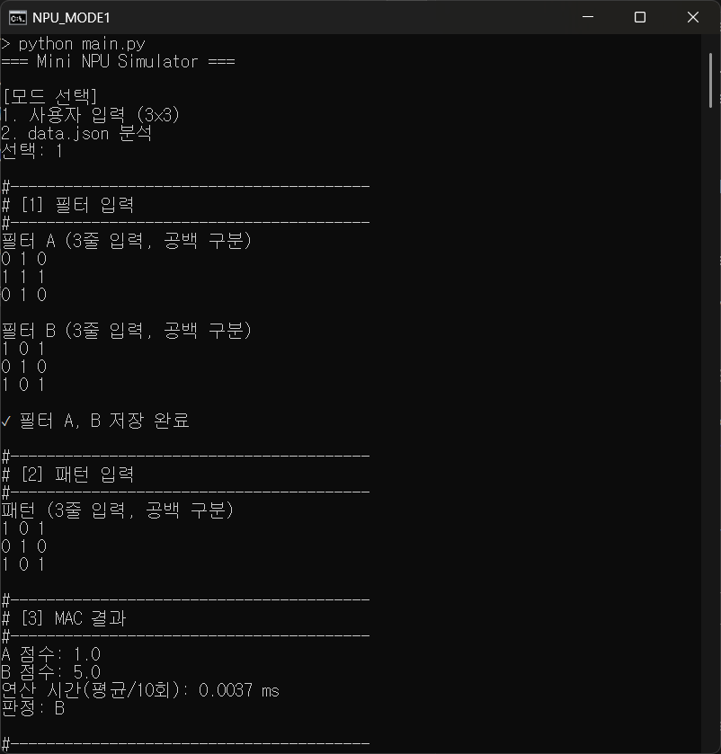
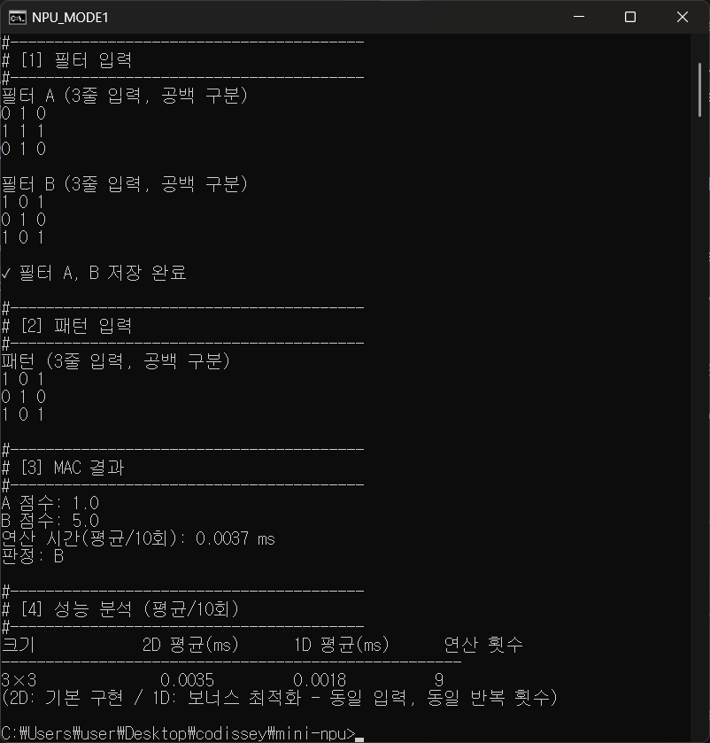
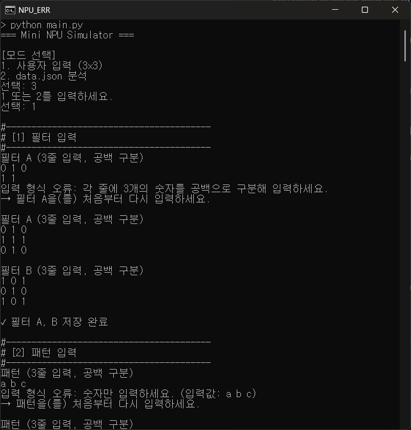
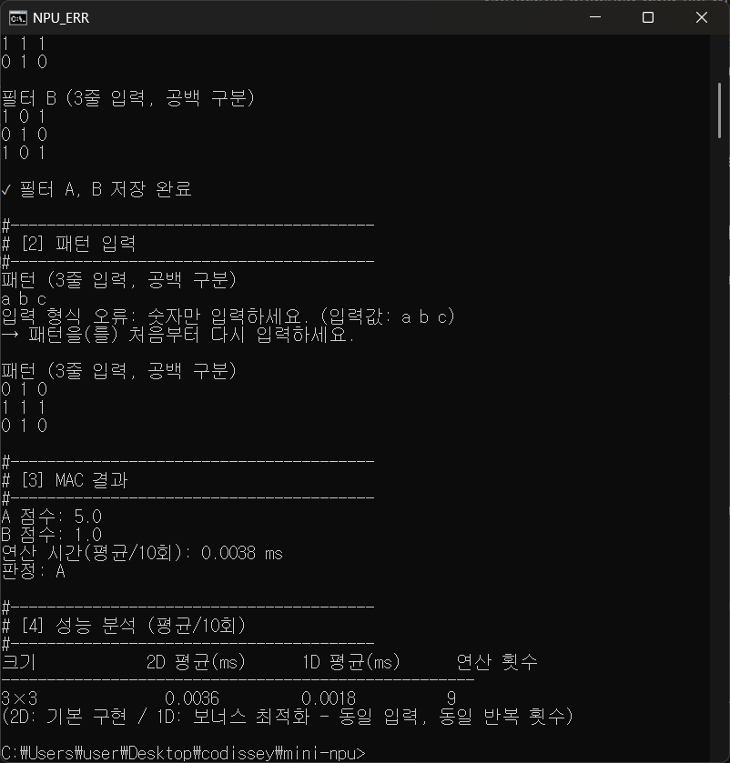
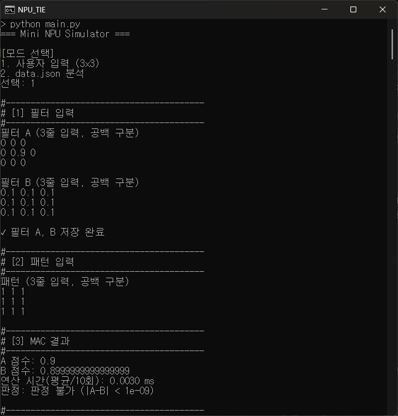
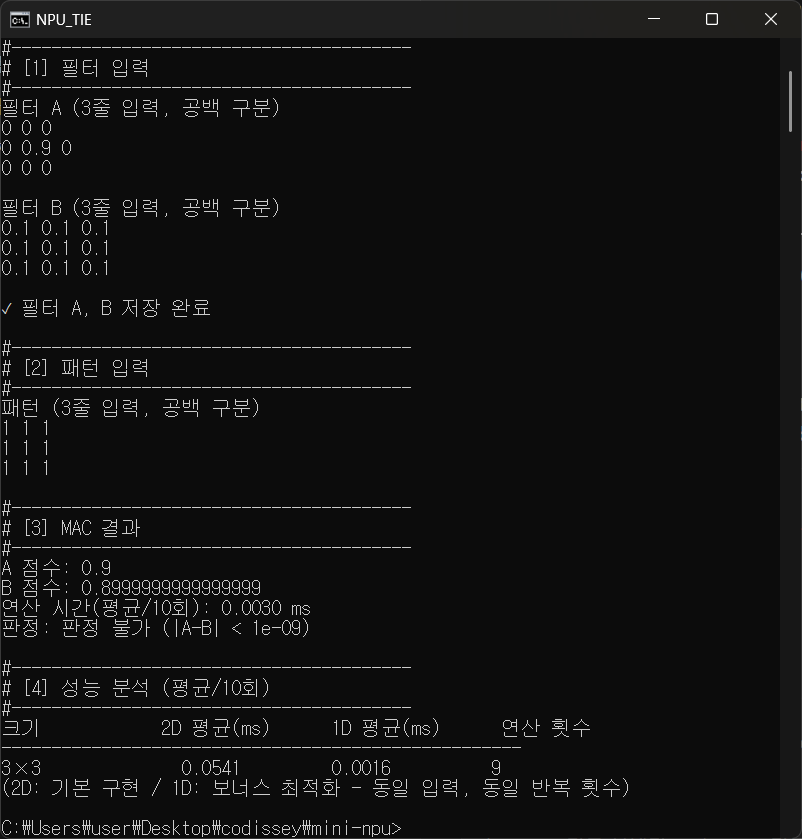
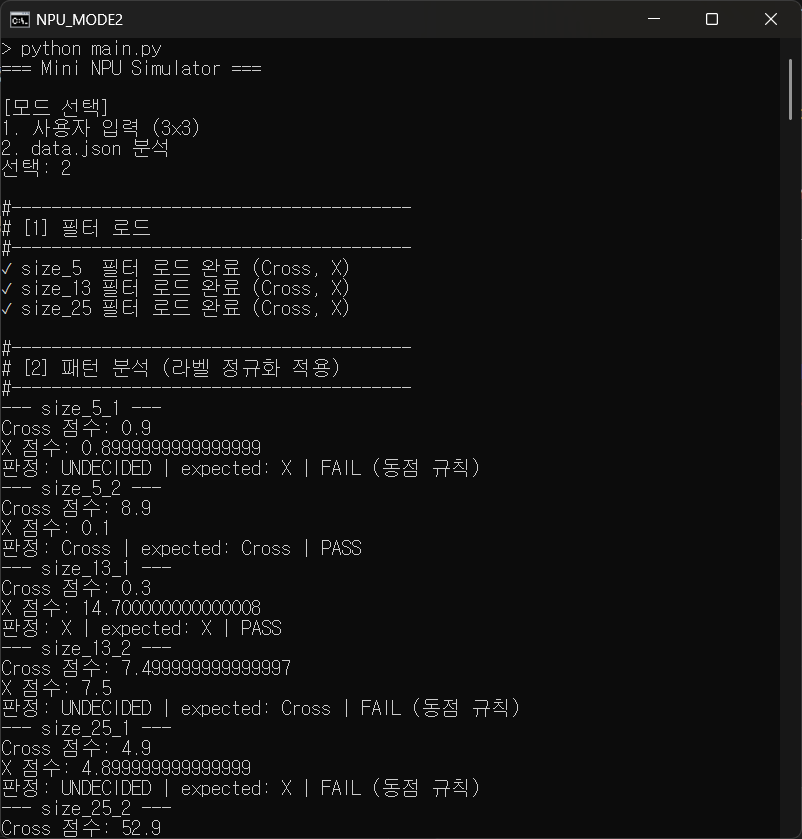
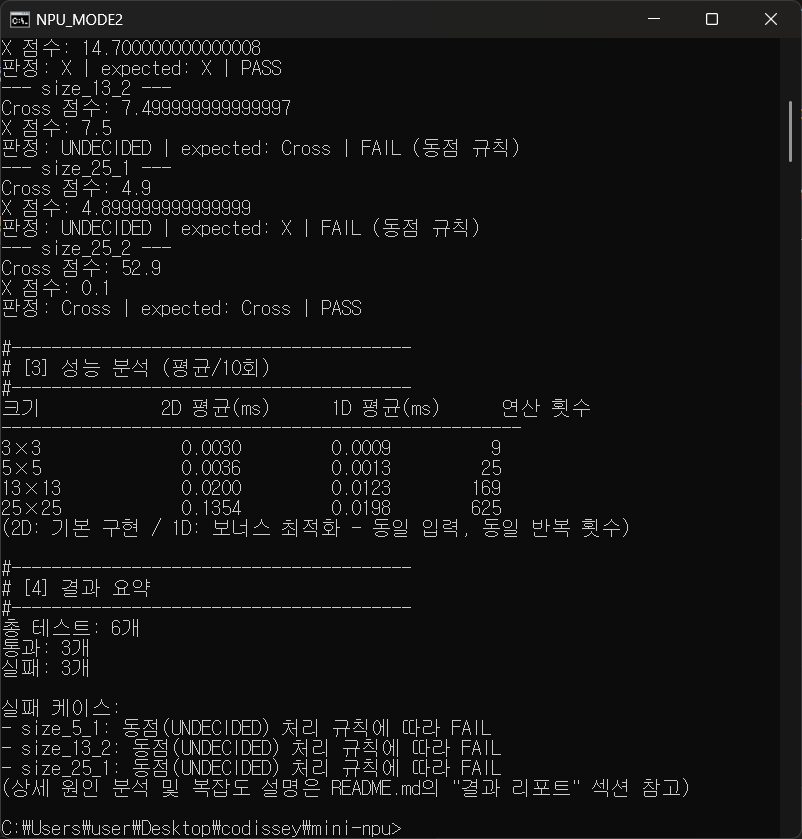
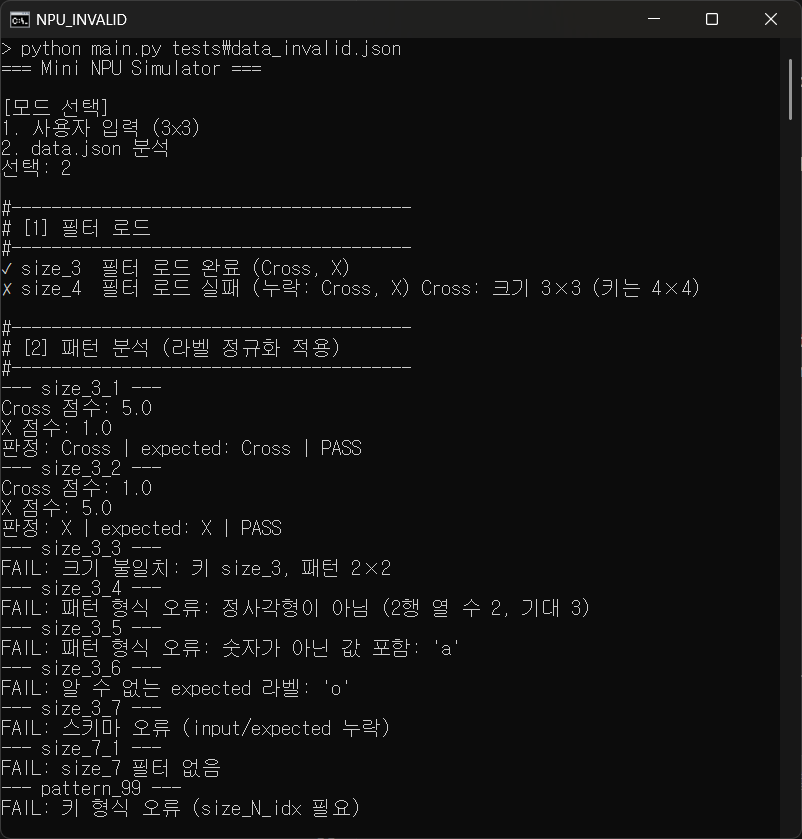
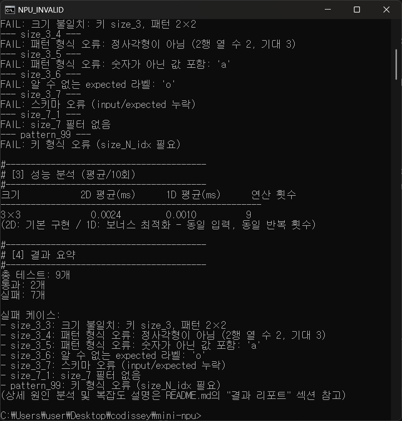

# Mini NPU Simulator

MAC(Multiply-Accumulate) 연산으로 십자가(Cross)와 X 패턴을 판별하는 Python 콘솔 애플리케이션입니다.
외부 라이브러리 없이 표준 라이브러리(`json`, `time`, `re`, `os`, `sys`)만 사용합니다.

## 실행 방법

```bash
python main.py                          # 실행 후 모드 선택 (1 또는 2)
python main.py tests/data_invalid.json  # 모드 2에서 다른 JSON 파일 분석 (오류 처리 확인용)
```

- 실행 환경: Python 3.8 이상 (Python 3.13.15에서 확인)
- `data.json`은 `main.py`와 같은 폴더에 둡니다. 인자로 경로를 주지 않으면 이 파일을 읽습니다.
- 모드 1: 3×3 필터 A, B와 패턴을 한 줄씩(공백 구분) 입력합니다.
- 모드 2: `data.json`의 5×5 / 13×13 / 25×25 필터와 패턴을 한꺼번에 판정합니다.
- Windows 콘솔에서 한글이나 `✓` 문자가 깨지면 먼저 `chcp 65001`을 실행합니다.

## 파일 구성

| 파일 | 설명 |
|---|---|
| `main.py` | 메인 실행 파일 (데이터 구조, MAC 연산, 두 모드, 성능 분석, 보너스 기능) |
| `data.json` | 과제 제공 데이터 (필터 3종, 패턴 6개) |
| `tests/data_invalid.json` | 의도적 오류 데이터 (크기 불일치, 비정사각형, 숫자 아님, 잘못된 라벨, 누락 키, 없는 필터, 잘못된 키) |
| `docs/screenshots/` | 실행 화면 캡처 |

## 구현 요약

### 데이터 구조
- `Matrix` 클래스가 n×n 2차원 리스트를 저장하고, `get(r, c)` / `set(r, c, v)`로 특정 위치의 값을 읽고 씁니다.
- `Matrix.from_rows()`는 JSON 배열을 검증합니다(비어 있지 않은지, 정사각형인지, 모든 값이 숫자인지). 문제가 있으면 `ValueError`를 냅니다.
- 3×3부터 25×25까지(그 이상도) 크기 제한 없이 처리합니다.

### MAC 연산
```python
for r in range(n):
    for c in range(n):
        total += pattern.get(r, c) * filt.get(r, c)
```
- 이중 반복문으로 위치별 곱을 더해 float 점수를 반환합니다. NumPy 같은 벡터화 라이브러리는 쓰지 않습니다.
- 패턴과 필터의 크기가 다르면 연산하지 않고 오류를 냅니다.

### 라벨 정규화
프로그램 안에서는 표준 라벨 `Cross`, `X` 두 가지만 씁니다. 입력 라벨은 `normalize_label()`이 앞뒤 공백을 지우고 소문자로 바꾼 뒤 아래 표로 변환합니다.

| 원본 | 위치 | 표준 라벨 |
|---|---|---|
| `+` | patterns.expected | Cross |
| `x` | patterns.expected | X |
| `cross` | filters 키 | Cross |
| `x` | filters 키 | X |

표에 없는 라벨(예: `o`)은 `None`이 되고, 해당 케이스는 "알 수 없는 expected 라벨"로 FAIL 처리합니다.
판정 결과와 expected를 모두 표준 라벨로 바꾼 뒤 비교하기 때문에 `'+'`와 `'Cross'`처럼 표기만 다른 경우가 FAIL로 잘못 나오지 않습니다.

### 키 규칙과 스키마 검증 (모드 2)
- 필터 키는 `^size_(\d+)$`, 패턴 키는 `^size_(\d+)_(\d+)$` 정규식으로 해석합니다. 패턴 키에서 N을 뽑아 `size_N` 필터를 선택합니다.
- 다음 경우는 프로그램을 멈추지 않고 **케이스 단위 FAIL**로 처리한 뒤 사유를 남깁니다.
  - 키 형식 오류, `input`/`expected` 누락
  - 해당 크기의 필터가 없음
  - 패턴이 정사각형이 아니거나 숫자가 아닌 값이 들어 있음
  - 키의 N과 실제 패턴 크기가 다름
- 필터 그룹에 Cross와 X가 둘 다 정상적으로 있어야 로드 성공으로 봅니다. 하나라도 빠지면 그 크기의 필터는 로드하지 않습니다.
- 그 밖의 예상하지 못한 예외도 `try/except`로 잡아 케이스 단위 FAIL로 처리합니다.

### 동점 처리 정책 (epsilon)
```python
EPSILON = 1e-9
if abs(score_a - score_b) < EPSILON:  -> UNDECIDED (모드 1에서는 "판정 불가")
```
`==`로 비교하지 않고 허용오차 안이면 동점으로 봅니다. 수학적으로 같은 값이 부동소수점 오차 때문에 아주 조금 다르게 계산되어도 한쪽으로 잘못 판정하지 않기 위해서입니다.

### 성능 측정
- `time.perf_counter()`로 **MAC 함수 호출 구간만** 10회 측정해 평균(ms)을 냅니다. 입력, 출력, 파일 읽기 시간은 포함하지 않습니다.
- 표 열: 크기(N×N) / 2D 평균(ms) / 1D 평균(ms, 보너스) / 연산 횟수(N²)
- 3×3은 패턴 생성기로 만든 행렬로, 5×5·13×13·25×25는 `data.json` 필터로 측정합니다.

### 보너스 과제
- **메모리 접근 최적화**: `Matrix.flatten()`으로 2차원 배열을 길이 N²의 1차원 리스트로 바꾸고, `mac_flat()`으로 단일 반복문 MAC을 수행합니다. 성능 표에서 같은 입력과 같은 반복 횟수로 2D와 1D 결과를 나란히 비교합니다.
- **패턴 생성기**: `make_cross(n)`, `make_x(n)`이 N×N 십자가와 X 패턴을 자동으로 만듭니다. 성능 분석의 3×3 입력과 아래 확장 측정에 사용했습니다.

## 실행 화면

### 모드 1: 사용자 입력 (예시대로 십자가 / X 필터 입력)



### 모드 1: 입력 오류 시 재입력 유도 (열 개수 부족 `1 1`, 숫자 아님 `a b c`)



### 모드 1: 판정 불가 (0.9 vs 0.8999999999999999)



### 모드 2: data.json 분석



### 모드 2: 의도적 오류 데이터 (케이스 단위 FAIL, 비정상 종료 없음)



## 결과 리포트

### 1. data.json 분석 결과

| 케이스 | Cross 점수 | X 점수 | 판정 | expected | 결과 |
|---|---|---|---|---|---|
| size_5_1 | 0.9 | 0.8999999999999999 | UNDECIDED | X (`x`) | FAIL |
| size_5_2 | 8.9 | 0.1 | Cross | Cross (`+`) | PASS |
| size_13_1 | 0.3 | 14.700000000000008 | X | X (`x`) | PASS |
| size_13_2 | 7.499999999999997 | 7.5 | UNDECIDED | Cross (`+`) | FAIL |
| size_25_1 | 4.9 | 4.899999999999999 | UNDECIDED | X (`x`) | FAIL |
| size_25_2 | 52.9 | 0.1 | Cross | Cross (`+`) | PASS |

**총 6개 / 통과 3개 / 실패 3개**

### 2. 실패 원인 분석
실패 원인을 "데이터/스키마 문제", "로직 문제", "수치 비교 문제" 세 가지로 나누어 확인했습니다.

1. **데이터/스키마 문제가 아닙니다.** 모든 키가 `size_N_idx` 규칙을 따르고, 6개 패턴 모두 키의 N과 실제 크기가 같으며, 필터 3종 모두 Cross와 X가 있습니다. expected 값 `'+'`와 `'x'`는 각각 Cross와 X로 정규화되었습니다. 그래서 라벨 표기 차이로 생긴 FAIL은 없습니다. 정규화 없이 `'x' == 'X'`나 `'+' == 'Cross'`로 바로 비교했다면 PASS 3개도 모두 FAIL이 되었을 것입니다.
2. **MAC 로직 문제가 아닙니다.** 실패한 3개 케이스의 점수를 `fractions.Fraction`(정확한 유리수 연산)으로 다시 계산하니 Cross와 X 점수가 **수학적으로 정확히 같았습니다**(0.9 = 0.9, 7.5 = 7.5, 4.9 = 4.9). 예를 들어 size_5_1은 X 패턴의 9칸 × X 필터 0.1 = 0.9이고, Cross 필터는 X 패턴과 중심 한 칸(0.9)만 겹쳐 0.9가 됩니다.
3. **실패의 직접 원인은 수치 비교(동점) 정책입니다.** 0.1, 0.9, 0.3 같은 값은 2진 부동소수점으로 정확히 표현되지 않습니다. 그래서 0.1을 9번 더하면 `0.8999999999999999`가 되는 것처럼 더하는 순서에 따라 끝자리가 달라집니다. 차이는 약 1e-16으로 epsilon(1e-9)보다 훨씬 작으므로, 정책대로 **동점(UNDECIDED)** 으로 판정했습니다. UNDECIDED는 expected(Cross/X)와 같지 않으므로 FAIL입니다.
4. **epsilon이 없었다면 어떻게 되었을까요?** `>`로 그대로 비교하면 size_5_1은 Cross(0.9 > 0.8999…), size_13_2는 X(7.5 > 7.4999…), size_25_1은 Cross가 됩니다. 이 판정은 **expected와 반대이고**, 부동소수점 오차라는 우연에 따라 결정된 결과입니다. 원래 동점인 데이터를 동점으로 보고하는 현재 동작이 더 정직하고 재현 가능한 결과입니다.
5. 따라서 이 3개 FAIL은 버그가 아니라 **이 데이터에서 필터가 두 패턴을 구분하지 못한다**는 사실을 드러낸 것입니다. 개선하려면 코드보다 데이터(필터 가중치)를 고쳐야 합니다. 예를 들어 X 필터 대각선 가중치를 0.1에서 1.0으로 올리거나 Cross 필터 중심값을 조정하면 점수 차이가 생깁니다.
6. 오류 처리 확인용 `tests/data_invalid.json`에서는 크기 불일치, 비정사각형, 숫자가 아닌 값, 알 수 없는 라벨, 키 누락, 없는 필터, 키 형식 오류 7가지가 모두 **사유와 함께 케이스 단위 FAIL**로 기록되었고, 프로그램은 결과 요약까지 정상 출력했습니다. 정상 케이스 2개는 PASS였습니다.

### 3. 시간 복잡도 분석
- MAC 연산은 N×N의 모든 칸에서 곱셈 1번과 덧셈 1번을 하므로 연산 횟수는 정확히 **N²** 이고, 시간 복잡도는 **O(N²)** 입니다. 메모리 사용량도 행렬 저장 크기인 O(N²)입니다.
- 실행 결과 표(10회 평균, 실행할 때마다 조금씩 다름)의 예입니다.

| 크기 | 2D 평균(ms) | 1D 평균(ms) | 연산 횟수(N²) |
|---|---|---|---|
| 3×3 | 0.0010 | 0.0005 | 9 |
| 5×5 | 0.0021 | 0.0007 | 25 |
| 13×13 | 0.0136 | 0.0040 | 169 |
| 25×25 | 0.0523 | 0.0232 | 625 |

- 13×13 → 25×25: 연산 횟수는 625/169 ≈ **3.7배**, 측정 시간은 0.0523/0.0136 ≈ **3.8배**로 거의 같은 비율로 늘었습니다. N이 약 2배가 되면 시간은 약 4배가 되므로 O(N²)와 맞습니다.
- 3×3 → 25×25는 연산 횟수가 약 69배인데 시간은 약 50배로 조금 덜 늘었습니다. 크기가 작을 때는 함수 호출이나 `range` 생성 같은 **고정 비용(상수항)** 이 전체 시간에서 차지하는 비중이 커서 N²에 비례하는 부분이 상대적으로 작게 보이기 때문입니다.
- 패턴 생성기로 더 큰 크기를 1000회 평균으로 측정한 결과입니다.

| 크기 | N² | 2D(ms) | 1D(ms) |
|---|---|---|---|
| 25×25 | 625 | 0.0477 | 0.0157 |
| 51×51 | 2,601 | 0.1978 | 0.0657 |
| 101×101 | 10,201 | 0.7332 | 0.2762 |

  N²가 약 4배씩 늘 때 시간도 약 3.7~4.1배씩 늘어 O(N²) 증가가 분명하게 확인됩니다.
- **최적화 비교(보너스)**: 1D 방식은 2D 방식보다 약 **2.5~3배** 빠릅니다. 2D 방식은 칸마다 `get()` 메서드 호출과 `data[r][c]` 이중 인덱싱을 하지만, 1D 방식은 리스트 하나를 인덱스 하나로 차례대로 읽기 때문입니다. 다만 복잡도는 둘 다 O(N²)로 같고, 줄어든 것은 상수 계수뿐입니다.
- 실제 AI 모델은 이런 MAC을 수억 번 반복합니다. CPU에서 순서대로 하면 시간이 N²에 비례해 늘어나므로, 여러 MAC을 동시에 처리하는 NPU 같은 병렬 하드웨어가 필요합니다.

### 4. 재현성 체크
- 모드 1에서 예시대로 십자가 필터(A)와 X 필터(B)를 넣고 X 패턴을 입력하면 A 1.0 / B 5.0 / 판정 B가 나옵니다.
- 모드 2의 PASS/FAIL 결과와 총합(6 / 3 / 3)이 콘솔 결과 요약과 일치합니다.
- 행/열 개수가 틀리거나 숫자가 아닌 입력은 안내 메시지를 출력한 뒤 해당 행렬을 처음부터 다시 입력하게 합니다. 크기나 스키마 불일치는 케이스 단위 FAIL로 처리합니다.
